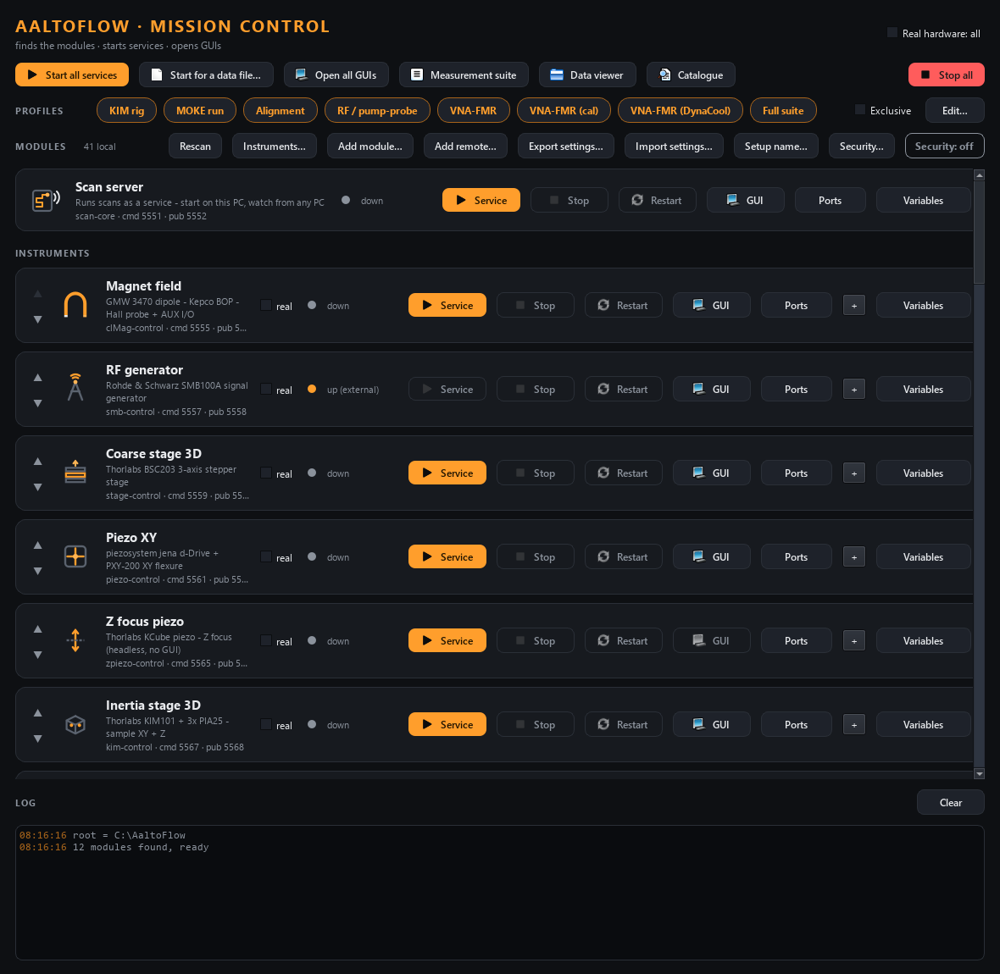

# AaltoFlow · Mission Control

The launcher. It **finds** the suite's modules, starts their services, opens
their GUIs, and shows what each one can do.



## Where the module list comes from

Nothing is listed by hand. Every folder `modules/<category>/<name>-control`
(a folder dropped straight next to this one still counts) that contains a
**`module.toml`** is a module (contract: `../INSTRUMENT_MODULE_GUIDE.md`
section 11). Its card shows the **name, description and icon** from that file.
Drop a new module folder in and its card appears within a few seconds (or press
**Rescan**); delete it and the card goes.

The **variables** (controls and measured values) come from the running service
itself, through `describe`. Press **Variables** on a card to see them. They are
remembered after the service stops, marked "last seen".

## Per module

- **Service / Stop**: start or stop the service. **real** runs it on the
  instrument (`--real`); unticked is the simulator.
- **GUI**: opens the front panel, connected to the live service when it is up.
- **Ports**: change the module's command/status ports on this PC. The service
  gets them on its next start; scan-core and other modules (the camera finds kim
  this way) follow. Clashes are refused.
- Status dot: green = running and started here, amber = up but started
  elsewhere (or a reachable remote service), grey = down.
- **Order**: the small up/down arrows on the left of a card move it, so the
  modules you use most sit at the top. Right-click a card for *Move to top*,
  *Move to bottom* and *Reset order*. The order is this PC's choice (saved in
  `suite_local.json`) and only changes what you see: services still start in
  the order they need (the camera after kim).

## Two copies of one module (instances)

One module can run more than once on this PC -- e.g. the oscilloscope module
for the Siglent scope and, at the same time, for an Analog Discovery 2. Press
**+** on the module's card (or right-click it > *Add instance…*) and give the
copy:

- a **name** (letters, digits, `_`), e.g. `dwf`. Its parameters in the
  measurement suite become `scope_dwf.*`, next to the module's own `scope.*`,
  so both can be used in one scan;
- its own **ports** (the first free pair above the module's is suggested;
  clashes are refused);
- **extra arguments** for its service, e.g. `--driver dwf`;
- optionally its own **settings file** (passed as `--config`; relative to the
  module folder), so the two copies do not share one `.ini`.

The copy gets a card of its own, marked `[instance]`, with Service / Stop /
Restart / GUI / Ports / real and **Remove** (forgets the copy; the module's
own card stays). It has its own real/sim switch and its own instrument
address (*Instruments…* offers it separately), can be put in profiles, and its
GUI connects to its own ports. Two copies cannot open the same instrument: the
second real service is refused its address ("address busy" on the card).
Saved in `../suite_local.json` under `modules.<key>.instances` (developer
notes, section 4g).

## Security (encryption)

**Security...** (next to *Instruments...*) manages this PC's key, the lab
keyring (the trusted PCs: add one from its key file, may-run-scans, retire /
restore) and the lab-wide policy, without the command line. The badge next
to it shows the lab's mode. How it works and the steps: the root README,
"Encryption and keys". The window is `security_window.py`; the logic is
`suite_common/keyadmin.py`, shared with `tools/keys.py`.

## Services on other PCs

**Add remote…** asks for host and ports. **Test connection** asks the service to
`describe` itself, which tells the launcher what kind of module it is, so it
borrows the icon, description and GUI of the same module on this PC. You can
still add it while the other PC is off: pick the module type by hand. A remote
card has a GUI button but no Start/Stop, since the service belongs to that PC.
**Remove** deletes it from the list; the service itself is not touched.

## Where the choices are saved

Ports, real/sim flags, the card order, remote services and instances go in `../suite_local.json`, which is
this PC's file (not in git). The measurement suite in scan-core reads the same
file, which is how it follows the launcher. Profiles are in `profiles.json`
next to this script.

**Export settings…** writes all of it into one `.zip`: `suite_local.json`,
`profiles.json`, scan-core's panel layouts, and every module's `*.ini`,
`*calibration*.json` and `Calibrations\` folder (the same "lab data" rule the
installer protects, so a new module is covered automatically), and the lab's
own window predictors in `scan-core/lab_predictors/*.py` (Python code: the
import summary says so, and a bundle can put code nowhere else). **Import
settings…** reads such a zip back on another PC or install folder: it lists
what would be new, replaced or skipped (paths outside the suite, modules not
installed here, anything that is not a settings file), asks, saves the files it
replaces to `../.suite_cache/settings-backup-<time>.zip` (import that to undo),
and rescans. Restart running services so they read their new `.ini`.

## Profiles

A chip per named subset: click it and the launcher starts just those services, in
dependency order (each module's `start_after`, e.g. the camera after kim),
then opens their GUIs. **Full suite** is always there and means every local
module; it is the ONLY built-in chip -- the suite does not know your lab's
setups. Make your own with **Edit…** (adds, renames and removes profiles) or
**Save as profile…** in *Start for a data file*; they are saved in
`profiles.json` next to this script and travel with *Export settings…*.
**Exclusive** first stops launcher-started services that are not in the
profile. A member that is not found on this PC today is kept, skipped when the
chip is clicked and greyed in the editor; a chip with NONE of its members
installed here is hidden (a `profiles.json` brought from another PC does not
fill the bar with buttons that do nothing).

## Start for a data file

**Start for a data file…** (or drop a `.nc` on the window) brings up the
modules a scan was measured with. Every scan file lists the instruments that
were connected (the instrument snapshot; an older file only has its scan
definition). The launcher cannot read a `.nc` itself, so it asks scan-core
(`python -m scan_core.file_modules FILE`, in scan-core's environment, in the
background) and then shows each module: its card here and what that card is
doing, *not installed on this PC*, or *on another PC*. Stopped modules are
ticked; **Start ticked** starts them in dependency order as a profile does,
**Start + open GUIs** opens their GUIs too, **Save as profile…** makes a chip
of them. The file's real/simulated mode is shown next to each card's `real`
box, with a warning when they differ, but never changed from here: ticking
`real` moves hardware, so that stays a click on the card.

## Run it

```bash
cd mission-control
uv sync
uv run python mission_control.py
uv run pytest -q
```

Dependencies: PySide6, pyzmq (to ask services to describe themselves) and
`../suite-common` (discovery). It never imports an instrument package; it
launches their scripts.

## How things launch

- Services run with each project's own `.venv\Scripts\python.exe`, so the
  process the launcher tracks *is* the service and Stop kills it cleanly. With no
  `.venv` it falls back to `uv run`, and Stop also issues `taskkill /T`.
- Every started process gets `AALTOFLOW_ENDPOINTS` (where every module listens)
  and `PYTHONUNBUFFERED=1` (so its prints reach the log at once).
- Stop terminates, then force-kills after 2 s. A force-kill skips a service's
  clean shutdown; for a real magnet stop it from its own window.
