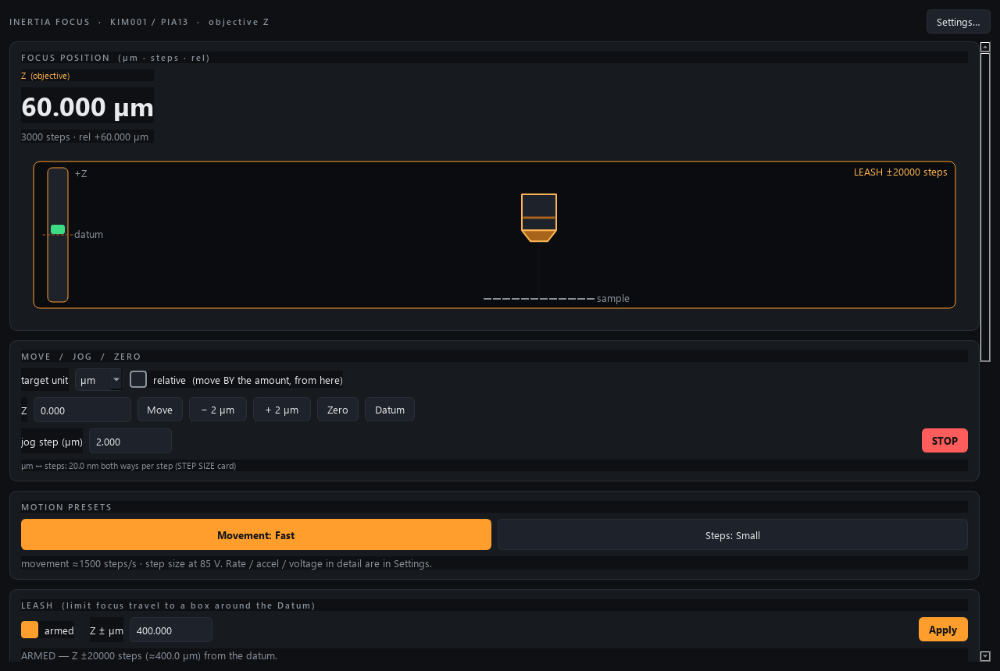

# kim001-control

Control module for an **objective-focus actuator**: one Thorlabs **PIA13**
piezo-inertia (slip-stick) actuator, 13 mm travel, driven by a single-channel
**KIM001** K-Cube controller, moving a microscope **objective** up and down
(focus, Z). Built to the AaltoFlow instrument blueprint
(`INSTRUMENT_MODULE_GUIDE.md`).

Ports: **command 5637**, **status 5638** (rule: `cmd = 5555 + 2n`, `pub = cmd + 1`).



*The focus axis at +60 um above the datum, with the leash armed at +/-20000 steps (+/-400 um at the nominal 20 nm per step).*

> **Status: simulation only.** Nothing here has run on a KIM001 yet. The real
> backend is kim-control's KIM101 backend (verified on hardware) cut down to one
> channel; every vendor call that is not confirmed for the KIM001 is marked
> `# VERIFY` in `src/kim001/backends/kinesis_kim001.py`.

## Why a separate module, and why it still says "X, Y, Z"

The sample stage on the rig is a KIM101 with three PIA25 (`kim-control`). The
objective focus is a different controller with ONE actuator, so it is a module of
its own (one physical controller, one service). But the camera already knows how
to focus through a kim service: its `remote_kim.KimZFocus` sends `axis="Z"` and
reads 3-wide status lists `[X, Y, Z]`. This module keeps **kim's verbs and status
keys exactly**, with the one real axis published as **Z**:

- status lists stay 3 wide (`position_steps`, `position_um`, `moving`,
  `um_per_step`, `um_per_step_fwd/bwd`, `limit_lo/hi`, ...); index 2 is the
  objective. X and Y are **not fitted**: position 0, never moving, limits 0..0.
  Status also carries `fitted: [false, false, true]`.
- every command for X or Y is refused:
  `{"ok": false, "error": "NotFitted: axis X is not fitted on a KIM001 (single-channel controller: only Z, the objective focus)"}`.
- `describe` lists only the Z parameters (position, velocity, drive voltage,
  moving, step counter, datum) plus the presets, leash, connection, hw_error
  and STOP.
- kim's X/Y camera px/step calibration (`start_px_calibration`,
  `move_image_px`) is refused the same way; `get_px_calibration` returns null.

So the camera drives this objective with the code it already has -- only the
module key (`kim001`, for the keyring) and the ports differ.

## Two languages, one calibration

A slip-stick actuator moves in tiny discrete **steps** with no encoder: the
position is the controller's step counter (open loop). You think in
**micrometres**, so the axis carries `um_per_step` -- per direction, because a
slip-stick actuator does not step equally up and down:

```
steps       = round(micrometres / um_per_step)
micrometres = steps x um_per_step
step_rate   = round(velocity_um_per_s / um_per_step)   (steps/s, clamped <= 2000)
```

The default 0.02 um (20 nm) is the PIA13 datasheet's nominal step. **Measure your
own**: the camera's AutoFocus tab > *Calibrate Z steps* measures both directions
from the image and writes them here (`set_calibration` axis Z, direction +1 / -1,
then `save_calibration` into `kim001.ini`). Or type them into the STEP SIZE card.
The drive **voltage** (85-125 V) sets the step size, so re-measure after changing it.

## Safety: limits and the leash

- **Travel limits**: +/- 650 000 steps around the datum = +/- 13 mm at 20 nm, i.e.
  the whole PIA13 travel either side. Symmetric because the datum is arbitrary.
- **Leash** (off by default, as in kim-control): press **Datum** at a focus you
  trust, then arm the leash; the objective can then not be driven more than
  `leash_z` steps (default 50 000 = 1 mm at 20 nm) from that focus -- e.g. into
  the sample. Armed, it replaces the travel limits, and the bounds in `describe`
  follow.
- **Start-up writes nothing** (adopt rule): the drive voltage / rate /
  acceleration are READ from the controller. Shutdown stops the actuator and
  leaves the focus where it is.
- **One controller, one service**: the real backend claims the KIM001's Kinesis
  serial with hwlock before it sends a byte; a second service on the same serial
  exits with code 4.

## Run

```powershell
cd modules\motion\kim001-control
uv sync --extra gui
uv run pytest -q
uv run scripts/run_service.py                      # simulator on 5637/5638
uv run scripts/run_service.py --real --serial <S>  # the real KIM001 (serial from its label / Kinesis)
uv run scripts/run_gui.py --connect localhost
uv run scripts/kim001_console.py status
uv run scripts/smoke_test.py
```

Without `--serial` (or `hardware.serial`) the backend picks the one Kinesis device
whose serial starts with `hardware.serial_prefix` -- a GUESS for the KIM001
(`97`, the KIM101's prefix; `# VERIFY`). If the KIM101 shares that prefix, a rig
with both connected is refused ("several ...") and a KIM101 picked by mistake is
refused after opening (its model name is checked). Give the serial explicitly.

## Files

```
backends/  base.py (Protocol) . sim.py (one actuator, default) . kinesis_kim001.py (real, lazy pylablib)
kim001.py  the brain: steps <-> um bridge, clamps, leash, X/Y refusals, position list
config.py  dataclasses + INI (kim001.ini, gitignored lab data); FITTED_AXES = (Z,)
net/       protocol . service . client . describe
apps/      gui (Z-only panel + FocusIndicator) . settings_dialog . theme . control_bar
probe.py   lists Kinesis devices for Mission Control's "Instruments on this PC"
```
