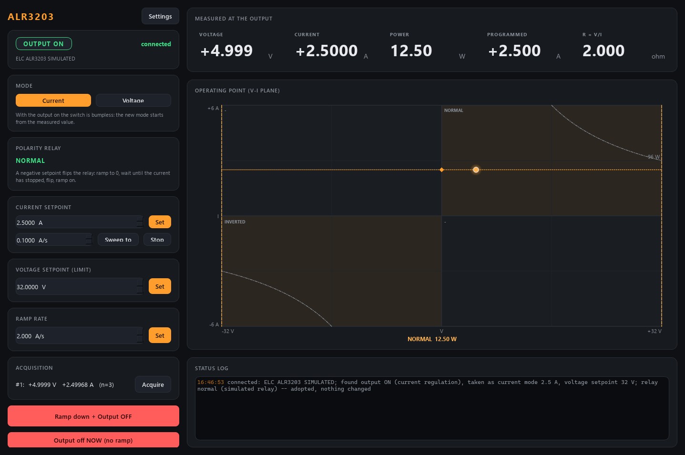

# alr3203-control -- ELC ALR3203 magnet supply

Control for an **ELC ALR3203** laboratory supply (0-32 V, 0-6 A, at most 96 W)
driving a magnet, made **bipolar by a polarity relay** on a digital line of the
setup's DAQ. Set a signed voltage or current; the module ramps it, switches the
relay at zero current, and reads back V and I. Ports 5635 / 5636.



*Simulation: the supply found live at 2.5 A in current mode into a 2 ohm coil
and adopted. The V-I plane is drawn as the magnet sees it: quadrant I with the
relay normal, III inverted; the dash-dot curve is the 96 W envelope.*

There is **no field loop** here: the Hall probe, the vacuum gauge and the
photodiodes are read by `usb6001-control` (see its `examples/vacuum_magnet.ini`).

## What it does

| | |
|---|---|
| **Two modes** | *Voltage*: you set V, the current setpoint is the limit (normally the full 6 A). *Current*: you set I, the voltage setpoint is the limit (normally 32 V). The supply regulates whichever it reaches first; `regulation` in status says which (CV / CC). |
| **Bumpless mode switch** | Allowed with the output ON. Voltage -> current: the current setpoint is lowered to the *measured* current, then the voltage goes to its limit -- the magnet keeps its current. Current -> voltage likewise. |
| **Signed setpoints** | Negative = the polarity relay inverted. A sign change ramps to 0, waits until the measured current is below `polarity.zero_current_A` (5 mA), flips the relay (the output may stay on, no extra wait), and ramps on. If the current does not stop within `zero_timeout_s` the change is refused and the output stays at 0. **The relay is never switched under current.** |
| **Hysteresis** | With the relay on one side, a setpoint on the other side smaller than `polarity.deadband_A` / `deadband_V` is output as 0 without flipping, so a setpoint dithering around zero does not keep clicking the relay. |
| **Ramps** | Every change is walked at `ramp.rate_A_per_s` / `rate_V_per_s` (a coil: V = L dI/dt). Output off = ramp to 0, then off -- also when the service stops (a restart for a code update included). |
| **Readback** | V and I (signed by the relay), power, R = V/I (display only), and a lamp when the supply sits on its 96 W envelope (`power_limited`). `acquire` gives scan-safe averaged readings. |
| **Adopt on start** | Nothing is written at start: the setpoints, the output switch and the relay are read and taken over (a live output stays live). |
| **Sweeps** | `ramp_current` for fly scans, also from -I to +I: at 0 it waits for the current to stop, flips the polarity relay and walks on -- one sweep to the caller. |

## The relay

`[polarity] driver`:

- `usb6001` -- the relay coil is on a digital OUTPUT line of **usb6001-control**
  (default `p0.0` = `Dev1/port0/line0`). That service owns the DAQ card; this
  one is a client of it (`set_do`), identified as a *machine* so the relay
  still switches while a person holds control of the DAQ window. Start
  usb6001-control first (the launcher does: `start_after`).
- `none` -- no relay: unipolar, negative setpoints are clamped to 0.
- `sim` -- the simulator's relay (default; the real service refuses it).

`inverted_level` says which line level means "inverted" (`high` by default).
**Check it on the rig** by watching the sign of the Hall probe.

## The supply's protocol

Manual (N_ALR3203_EN, Appendix A) and ELC's own Python library ALR32XX: USB
virtual COM port, 9600 baud 7E1, `0 VOLT WR 1250\r` (mV / mA) -> `0 OK\r`;
`0 CURR MES\r` -> `0 OK 450\r`; `0 MODE RD` -> 0 off / 1 CV / 2 CC. A write
answered `0 LOCAL` is retried once after `REM WR 1`; `REM WR 0` on close gives
the front panel back. We do not use ELC's library itself: its auto-connect
writes to every COM port on the PC. The port here is configured
(`[hardware] com` or `--com`), never searched.

## Run

```powershell
cd modules\source\alr3203-control
uv sync --extra gui                     # simulator + GUI
uv sync --extra gui --extra real        # on the setup's PC: + pyserial (name BOTH extras)
uv run pytest -q
uv run scripts/run_service.py                    # simulated supply, coil and relay
uv run scripts/run_service.py --real --com COM5  # the real supply
uv run scripts/run_gui.py --connect localhost
uv run scripts/alr3203_console.py status
```

This PC's settings go in `alr3203.ini` next to `module.toml` (gitignored),
loaded by the service at start: the COM port, `[polarity] driver = usb6001`,
the relay line and level.

*Built 2026-11-09 in simulation; not yet run on the real supply.*
